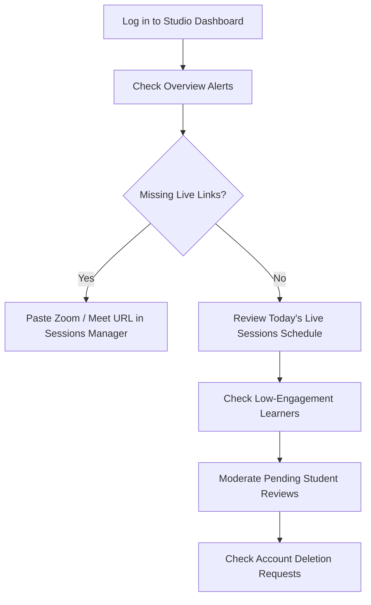

# Naman Studio — Administrator & Staff Operations Manual
## ABrainoConscious Platform (admin.abrainoconcious.com)

Welcome to the operations and administration manual for **Naman Studio**, the administrative control room for Naman and the ABrainoConscious mentorship team.

This manual outlines daily operational rhythms, student moderation workflows, security protocols, promotional mechanics, and crisis escalation procedures.

---

## 1. Authentication, Access & Team Management

### 1.1 Passwordless Team Bootstrap
Naman Studio enforces a **passwordless authentication architecture**:
- **Staff and Administrators authenticate via Google OAuth or Supabase Magic Link.**
- No static passwords exist in the database, eliminating password spray and credential-stuffing attack vectors.
- Invited team members do not receive automated password emails. Direct them to sign in at `admin.abrainoconcious.com` using the exact email address configured in the Team roster.

### 1.2 Role-Based Access Control (RBAC) Matrix

| Operational Area | Scope | Administrator | Staff | Functional Capabilities |
| :--- | :--- | :---: | :---: | :--- |
| **Overview Dashboard** | Insights | Full | Content Stats | View active learners, daily sessions, and revenue metrics. |
| **Programs Manager** | Cohorts | Full | Read & Edit | Create, edit, and publish 30-day challenges and workshops. |
| **Live Sessions** | Broadcasting | Full | Full | Generate daily schedules, set IST timings, configure protected live links. |
| **Announcements** | Outreach | Full | Full | Broadcast cohort notifications, urgency badges, and pin important updates. |
| **Students Directory** | Learners | Full | Read & Note | View learner progress, enroll/revoke cohort seats, handle account inquiries. |
| **Attendance & Tasks** | Engagement | Full | Full | Monitor daily attendance, track completion rates, filter low-engagement students. |
| **Reviews Queue** | Moderation | Full | Full | Approve, hide, or moderate student course feedback and testimonials. |
| **Coupons Engine** | Marketing | Full | Simulator Only | Create discount codes, set caps, configure validity windows, run simulator. |
| **Orders & Payments** | Finance | View Only | No Access | Read-only ledger, revenue cards (₹0 on hold), payment interest demand. |
| **Team Management** | Security | Full | No Access | Invite staff, modify roles, revoke team privileges via Edge Function. |
| **Platform Settings** | Configuration | Full | No Access | Brand assets, legal policies, GST configuration, maintenance mode toggle. |
| **Audit Log Trail** | Compliance | Full | No Access | Inspect append-only administrative trail with before/after state diffs. |

### 1.3 Security Guardrails & Team Safety
The backend Edge Function (`manage-team`) and PostgreSQL RLS enforce three safety invariants:
1. **Last Administrator Protection:** The system will reject any attempt to demote or remove the sole remaining administrator with HTTP 400 (`Cannot remove the last active administrator`).
2. **Self-Demotion & Self-Removal Lock:** An administrator cannot demote or remove their own account from within their active session, preventing accidental lockout.
3. **Session Revocation:** Removing a team member revokes their administrative privileges immediately. The account drops back to a standard student role without deleting their personal profile.

---

## 2. Daily Operational Routine

Perform this routine once every morning (recommended: **07:00 IST**) and once before evening sessions:

### Step 1: Check the Overview Dashboard (`/`)
- **Active Enrolments:** Verify total active student cohort seats.
- **Sessions Today:** Check the count of scheduled live calls for the day.
- **Needs Attention Queue:** Look for high-priority alerts:
  - **Missing Live Link Warning:** Highlights any session scheduled within the next 2 hours that lacks a live meeting link. Click **"Fix Link"** to immediately open the session editor and supply the URL.
  - **Account Deletion Requests:** Pending student data requests requiring action.
  - **Pending Reviews:** New student feedback awaiting moderation.

### Step 2: Confirm Live Session Links (`/sessions`)
1. Select the active cohort (e.g., *30-Day Emotional Resilience Challenge*).
2. Confirm the **"Today"** session card:
   - Verify the platform (Zoom, Google Meet, or YouTube Live).
   - Verify the scheduled time in **Indian Standard Time (IST)**.
   - Ensure the `session_links` entry is populated and valid.
3. *Note on Security:* Live links are strictly protected. Students cannot inspect DOM or network traffic to extract links until the configured join window opens (default: 60 minutes prior to call time).

---

## 3. Student Moderation & Access Control

Navigate to **Students Directory** (`/students`).

### 3.1 Searching and Filtering
- Search instantly by **Full Name**, **Email Address**, **Phone Number**, or **UUID**.
- Filter by status (**All**, **Active**, **Blocked**) or program enrollment.

### 3.2 Student Detail Drawer
Click on any student row to view their 360° profile drawer:
- **Attendance Percentage:** Real-time ratio of live calls attended vs scheduled.
- **Task Completion Rate:** Proportion of daily exercises completed.
- **Enrolled Cohorts:** Complete list of active and completed programs with enrollment dates.
- **Direct Outreach:** Click **"Compose Announcement"** to pre-fill the announcements editor with a notification targeted to the student's cohort.

### 3.3 Manual Cohort Enrolment & Revocation
- **Enrolling a Student:** Click **"Manual Enrol"**, select the student, choose the program, and optionally set a cohort expiry date. This atomically creates the enrollment record, sets status to `active`, and sends a welcome notification to the student's inbox.
- **Revoking Enrolment:** In the student drawer, select the active program and click **"Revoke Access"**. Supply a mandatory administrative reason (e.g., *"Student requested refund"* or *"Transferred to next cohort"*). The student's view switches cleanly to the dignified "Access Ended" screen.

### 3.4 Blocking an Abusive or Disruptive Learner
If a participant exhibits harassment, hate speech, or piracy:
1. Open the student drawer and click **"Block Learner"**.
2. Enter a clear, factual reason in the modal (e.g., *"Repeated violation of live call code of conduct"*).
3. Confirm the action.
4. **Immediate Impact:**
   - Database flag `profiles.is_blocked` is set to `true`.
   - All student RPCs (`get_session_link`, `complete_task`, `submit_review`) immediately reject calls from this user with code `403 Forbidden`.
   - The student's browser immediately redirects to the **"Account Paused"** screen with support contact information.
   - An entry is immutably recorded in the Audit Log.

### 3.5 Account Deletion Requests (DPDP / GDPR Compliance)
Under the **"Account Deletion Requests"** tab:
1. Review pending student deletion requests.
2. If genuine:
   - Click **"Execute Deletion"**.
   - Anonymizes personal data (`full_name` set to *"Former Student"*, `phone` cleared, `avatar_url` removed) while preserving anonymized financial and attendance records for auditing.
   - Sets status to `completed`.
3. If fraudulent or submitted in error:
   - Click **"Reject"** and supply an explanation (e.g., *"Identity could not be verified"*).

### 3.6 Secure CSV Data Export
Click **"Export CSV"** on the students directory or attendance screens:
- All exports automatically escape potential spreadsheet formula characters (`=`, `+`, `-`, `@`, `\t`) with prepended single quotes.
- This neutralizes CSV formula injection exploits when files are opened in Microsoft Excel or Google Sheets.

---

## 4. Attendance & Engagement Monitoring

Navigate to **Attendance & Task Reports** (`/attendance`).

### 4.1 Daily Live Session Logs (Per-Session View)
- View attendance rosters for each individual session.
- Displays the exact IST timestamp when each student clicked "Join Live".
- Filter by platform or session status (`scheduled`, `live`, `completed`).

### 4.2 Disengagement Detection (Per-Student View)
1. Switch to the **"Per-Student Breakdown"** tab.
2. Toggle **"Show low engagement learners only"** ($\le 50\%$ attendance or task completion).
3. **Recommended Action:**
   - Do NOT send punitive or reprimanding messages.
   - Naman's mentorship voice is warm and empathetic. Send a gentle cohort announcement or check-in: *"We noticed life got busy this week — remember you can always catch up on your daily contemplation exercises at your own pace."*

---

## 5. Review Moderation Queue

Navigate to **Student Reviews** (`/reviews`).

### 5.1 Moderation Policy
- **Pending Tab:** All newly submitted student testimonials appear here first.
- **Approved:** Visible on public landing pages and student course detail cards.
- **Hidden:** Hidden from public display without deleting the student's submission.
- **Delete:** Permanently removes spam, vulgarity, or accidental submissions.

### 5.2 Automatic Rating Synchronization
When you approve, hide, or delete a review, an automated PostgreSQL trigger (`sync_program_rating_on_review`) immediately recalculates the target program's `rating` average and `reviews_count` in real time.

---

## 6. Promotional Coupons & Discount Engine

Navigate to **Promotional Coupons** (`/coupons`).

### 6.1 Creating a Coupon
Click **"Create Coupon"** and configure:
- **Code:** Branded alphanumeric code (e.g., `DEEPAVALI50`, `EARLYBIRD`). Automatically converted to uppercase.
- **Auto-Generate Tool:** Click **"Auto-generate Code"** to generate randomized branded codes (e.g., `GROWTH-7X9B`).
- **Discount Type:**
  - **Percentage:** Between 1% and 100% (e.g., 20% off).
  - **Flat Amount:** Fixed Rupee discount entered in Rupees (converted to paise internally).
- **Minimum Spend:** Minimum cohort price required for the coupon to apply.
- **Max Uses & Per-User Limit:** Cap overall redemptions or limit to 1 per student.
- **Applicability:** Apply to all current and future programs or restrict to specific cohorts.
- **Validity Window:** Start date and expiration date in **IST**.

### 6.2 The Interactive Coupon Simulator
Before publicizing any promo code across Instagram, YouTube, or email newsletters:
1. Click **"Test this coupon"** on any coupon row.
2. Select the target program from the dropdown.
3. The simulator evaluates the coupon against PostgreSQL business rules in real time:
   - Checks validity dates, minimum purchase thresholds, and program restrictions.
   - Renders a live breakdown: Original Price $\rightarrow$ Discount $\rightarrow$ Final Payable Amount.
   - Displays exact validation error messages if the code is invalid or expired.

---

## 7. Orders & Payments Ledger (On-Hold Scope)

Navigate to **Orders & Payments** (`/payments`).

### 7.1 Current Status & Boundaries
In compliance with project phase requirements, **Razorpay payment processing is on hold**:
- The ledger displays read-only real transactions and ₹0 metrics.
- Action buttons (**"Issue Refund"**, **"Download Invoice"**, **"Reconcile Gateway"**) are intentionally disabled with the label: *"Available when payments go live"*.
- **Student Payment Interest:** The demand panel displays counts and emails of students who requested notification when paid enrollment opens. Use this list to gauge pre-launch demand per program.

---

## 8. Platform Configuration & Settings

Navigate to **Platform Settings** (`/settings`).

Only administrators have access to this section. All configuration is stored in the singleton `site_settings` table.

### 8.1 Tab Reference
1. **Brand & Identity:** Organization title, logo URL, favicon URL, support email, WhatsApp number, YouTube subscriber count.
2. **Business & Invoicing:** GST toggle, GSTIN number, GST rate (18%), registered company address and PAN.
3. **Legal Pages:** Markdown / HTML source for Terms of Service (`/terms`), Privacy Policy (`/privacy`), Refund Policy (`/refund-policy`), and Medical Disclaimer.
4. **Crisis & Helplines:** Managed directory of emergency psychological support helplines (see Section 9).
5. **Live Sessions:** Whitelisted meeting hosts (`zoom.us`, `meet.google.com`, `youtube.com`, `youtu.be`), join window before session (15–60 min), and join window after session (120 min).
6. **Site & Maintenance:** Toggle Platform Maintenance Mode. When activated, all student routes display a calm *"System maintenance in progress"* screen while administrative access remains unaffected.
7. **Security & Auth:** Configured session idle timeouts and authentication provider indicators.

---

## 9. Crisis Escalation & Psychological Support Protocol

> [!IMPORTANT]
> **ABrainoConscious is an educational self-development platform. It is NOT a clinical psychotherapy, psychiatric clinic, or suicide crisis prevention service.**

### 9.1 When to Escalate
If a student expresses severe clinical depression, psychosis, suicidal ideation, or self-harm in a live call chat, community forum, review, or support message:
1. **Do not attempt amateur therapy or diagnosis.**
2. **Respond with calm compassion and immediate helpline referral.**
3. **Escalate immediately to the verified Indian national helplines listed below.**

### 9.2 Verified Crisis Helplines (Integrated in Settings & Support)

| Service Name | Number / Code | Hours | Region & Details |
| :--- | :--- | :---: | :--- |
| **Tele-MANAS** (Govt. of India) | **14416** / 1800-891-4416 | 24/7 | National toll-free mental health helpline (20+ Indian languages). |
| **KIRAN Helpline** (Govt. of India) | **1800-599-0019** | 24/7 | Ministry of Social Justice & Empowerment helpline. |
| **Vandrevala Foundation** | **+91 9999 666 555** | 24/7 | Free, confidential psychological counselling across India. |

These numbers are rendered in Platform Settings (`/settings`), public support pages (`/support`), and directly inside live session drawers for immediate student access.

---

## 10. Audit Log & Compliance

Navigate to **Audit Log** (`/audit-log`).

### 10.1 Immutable Audit Trail
Every sensitive administrative action triggers an append-only entry in `audit_logs`:
- Student manual enrollment and access revocation
- Student blocking and unblocking (with reason)
- Account deletion execution
- Coupon creation, modification, and deactivation
- Platform settings and legal text updates
- Team role changes and member removals

### 10.2 Inspecting State Diffs
Click **"Inspect Diff"** on any audit log entry to open the JSON before-and-after state viewer. This provides cryptographic-level traceability of exactly what parameters were altered, by whom, and at what timestamp.

---
*End of Administrator & Staff Operations Manual.*

