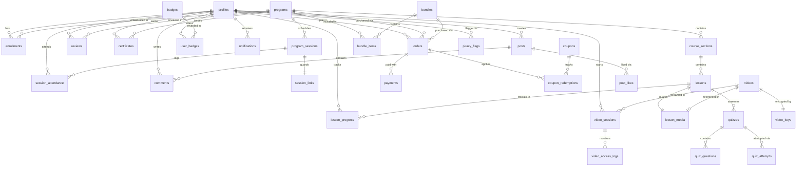

# ABrainoConscious Database Architecture & Security Guide (Step 2)

This document provides the definitive architectural reference, entity relationship model, Row Level Security (RLS) policies, anti-piracy mechanisms, and operational workflows for the ABrainoConscious PostgreSQL database.

---

## 1. Entity-Relationship Diagram (Mermaid)



---

## 2. Protected Links by Design (Security Architecture)

To eliminate the danger of accidental link leaks through public API responses, CDN caching, or client state hydration, secret URLs and video references are isolated into distinct tables protected by strict Row Level Security (RLS):

1. **`session_links` (`session_id`, `live_url`, `recording_url`):**
   - The public table `program_sessions` contains only session metadata (title, day number, schedule, task body).
   - The secret join URL (`live_url`) and playback URL (`recording_url`) are stored solely in `session_links`.
   - Access is restricted exclusively to students with an active enrollment in that program, verified via `has_active_enrollment(program_id)` or `is_staff_or_admin()`.

2. **`lesson_media` (`lesson_id`, `video_id`, `content_url`, `attachments`, `subtitles`):**
   - The public table `lessons` holds only the curriculum outline (title, duration, free preview flag, sort order).
   - Secret video identifiers and downloadable attachments reside exclusively in `lesson_media`.
   - Access requires `can_view_lesson(lesson_id)` which evaluates to `true` if the lesson is marked `is_free_preview = true`, if the caller has an active enrollment, or if the caller is staff/admin.

3. **`video_keys` (`video_id`, `encrypted_key`):**
   - Encrypted AES-128 HLS decryption keys are stored in `video_keys`.
   - RLS strictly denies access to all client roles (`USING (false)`). Keys can only be accessed by the backend Edge Function (`get-playback`) utilizing the `service_role` key.

---

## 3. Row Level Security (RLS) Policy Matrix

| Table | Operation | Granted Roles / Actors | Policy Condition / Enforcement |
| :--- | :--- | :--- | :--- |
| **`profiles`** | SELECT | Owner, Staff, Admin | `id = auth.uid() OR is_staff_or_admin()` |
| | UPDATE | Owner, Admin | `id = auth.uid() OR is_admin()`, role/blocked changes blocked by trigger |
| **`programs`** | SELECT | Public, Staff, Admin | `(status IN ('published', 'live', 'completed') AND deleted_at IS NULL) OR is_staff_or_admin()` |
| | INSERT / UPDATE | Staff, Admin | `is_staff_or_admin()` |
| | DELETE | Admin | `is_admin()` |
| **`program_sessions`** | SELECT | Public (if program published) | Program is published/live/completed or `is_staff_or_admin()` |
| | INSERT / UPDATE / DELETE | Staff, Admin | `is_staff_or_admin()` |
| **`session_links`** | SELECT | Enrolled Students, Staff, Admin | `has_active_enrollment(program_id)` |
| | ALL | Staff, Admin | `is_staff_or_admin()` |
| **`course_sections`** | SELECT | Public (if program published) | Program is published/live/completed or `is_staff_or_admin()` |
| | ALL | Staff, Admin | `is_staff_or_admin()` |
| **`lessons`** | SELECT | Public (if published) | `is_published = true` and program published, or `is_staff_or_admin()` |
| | ALL | Staff, Admin | `is_staff_or_admin()` |
| **`lesson_media`** | SELECT | Authorized Viewers | `can_view_lesson(lesson_id)` (free preview, active enrollment, or staff) |
| | ALL | Staff, Admin | `is_staff_or_admin()` |
| **`bundles`** | SELECT | Public | `is_published = true OR is_staff_or_admin()` |
| | ALL | Staff, Admin | `is_staff_or_admin()` |
| **`bundle_items`** | SELECT | Public | Bundle is published or `is_staff_or_admin()` |
| | ALL | Staff, Admin | `is_staff_or_admin()` |
| **`coupons`** | SELECT | Public (Active only), Staff, Admin | `(is_active = true AND (valid_until IS NULL OR valid_until > NOW())) OR is_staff_or_admin()` |
| | ALL | Admin | `is_admin()` |
| **`orders`** | SELECT | Owner, Admin | `user_id = auth.uid() OR is_admin()` |
| | INSERT | Owner | `user_id = auth.uid()` |
| | ALL | Admin | `is_admin()` |
| **`payments`** | SELECT | Order Owner, Admin | Order belongs to `auth.uid()` or `is_admin()` |
| | ALL | Admin | `is_admin()` |
| **`coupon_redemptions`** | SELECT | Owner, Admin | `user_id = auth.uid() OR is_admin()` |
| **`enrollments`** | SELECT | Owner, Staff, Admin | `user_id = auth.uid() OR is_staff_or_admin()` |
| | INSERT / UPDATE / DELETE | Admin, Service Role | Blocked for students via trigger; managed by `grant_enrollment` |
| **`announcements`** | SELECT | Targeted Audience | Audience match (`all`, `program`, `user`) and valid dates |
| | ALL | Staff, Admin | `is_staff_or_admin()` |
| **`notifications`** | SELECT / UPDATE | Owner, Admin | `user_id = auth.uid() OR is_admin()` |
| | INSERT / DELETE | Admin, Service Role | `is_admin()` |
| **`lesson_progress`** | ALL | Owner, Staff, Admin | `user_id = auth.uid() OR is_staff_or_admin()` |
| **`session_attendance`**| INSERT | Enrolled Student | `user_id = auth.uid() AND has_active_enrollment(program_id)` |
| | SELECT | Owner, Staff, Admin | `user_id = auth.uid() OR is_staff_or_admin()` |
| **`reviews`** | SELECT | Public, Owner | `is_published = true OR user_id = auth.uid() OR is_staff_or_admin()` |
| | INSERT | Enrolled Student | `user_id = auth.uid() AND has_active_enrollment(program_id)` |
| **`certificates`** | SELECT | Public | Verification via `/verify/:code` is open |
| | ALL | Admin | `is_admin()` |
| **`quizzes`** | SELECT | Enrolled / Preview Viewers | `has_active_enrollment(program_id)` or `can_view_lesson(lesson_id)` |
| **`quiz_attempts`** | ALL | Owner, Staff, Admin | `user_id = auth.uid() OR is_staff_or_admin()` |
| **`badges`** | SELECT | Public | `true` |
| **`user_badges`** | SELECT | Owner, Staff, Admin | `user_id = auth.uid() OR is_staff_or_admin()` |
| **`posts`** | SELECT | Enrolled Students, Staff, Admin | `has_active_enrollment(program_id) OR is_staff_or_admin()` |
| | INSERT | Enrolled Student | `user_id = auth.uid() AND has_active_enrollment(program_id)` |
| **`comments`** | SELECT / INSERT | Enrolled Students | Post program enrolled or staff |
| **`post_likes`** | ALL | Enrolled Students | Post program enrolled |
| **`site_content`** | SELECT | Public | `true` |
| | ALL | Staff, Admin | `is_staff_or_admin()` |
| **`site_settings`** | SELECT | Public | `true` |
| | ALL | Admin | `is_admin()` |
| **`audit_log`** | SELECT | Admin | `is_admin()` |
| **`videos`** | SELECT | Staff, Admin | `is_staff_or_admin()` |
| **`video_keys`** | ALL | Denied to all clients | `false` (Service role only) |
| **`video_sessions`** | ALL | Session Owner, Admin | `user_id = auth.uid() OR is_admin()` |
| **`video_access_logs`**| ALL | Admin, Service Role | `is_admin()` |
| **`piracy_flags`** | INSERT | Authenticated Student | `auth.uid() IS NOT NULL` |
| | ALL | Admin | `is_admin()` |
| **`account_deletion_requests`** | INSERT / SELECT | Owner | `user_id = auth.uid()` |
| | SELECT / UPDATE | Admin | `is_admin()` |

---

## 4. Database Functions, Triggers, & Stored Procedures

### Helper Security Functions
- `is_admin()`: Returns `true` if current caller has `profiles.role = 'admin'` and `is_blocked = false`.
- `is_staff_or_admin()`: Returns `true` if caller is `admin` or `staff`.
- `has_active_enrollment(program_id UUID)`: Returns `true` if caller has an active, unexpired enrollment (or is staff/admin).
- `can_view_lesson(lesson_id UUID)`: Returns `true` if the lesson is published and is either a free preview or the caller is actively enrolled in the course.

### Core Triggers
- `trg_on_auth_user_created`: Automatically creates a `profiles` entry upon new Supabase user signup with default role `student`, pulling Google metadata (`full_name`, `avatar_url`/`picture`) while strictly preserving existing admin roles.
- `trg_on_auth_user_updated`: Synchronizes profile metadata (`full_name`, `avatar_url`) whenever `auth.users` is updated (e.g., initial Google sign-in by pre-seeded users).
- `trg_protect_profile_fields`: Prevents non-admin callers from modifying `role` or `is_blocked`.
- `trg_protect_enrollments`: Disallows direct inserts/updates to `enrollments` from client APIs; all access changes must originate from `grant_enrollment` or administrator intervention.
- `audit_trigger_func`: Automatically records state diffs into `audit_log` on critical tables (`programs`, `program_sessions`, `announcements`, `coupons`, `site_content`, `site_settings`, and `profiles` role/block changes).

### Stored Procedures & RPCs
- `grant_enrollment(order_id, razorpay_payment_id, signature, amount, method, payload)`:
  - Atomic transaction: marks order paid, records payment, creates unique enrollment (`user_id, program_id`), logs coupon redemption, creates congratulatory student notification, and returns enrollment row.
  - Strictly idempotent: safe against concurrent webhook execution and repeated client redirects.
- `get_public_stats()`: Returns public statistics (total students, active programs, lessons, and content hours) safely for anonymous landing page hydration.
- `get_my_programs()`: Fetches the student's active enrolled programs along with attendance and progress counts.
- `mark_announcement_read(id)`: Logs announcement read status.
- `mark_notification_read(id)`: Marks user notification as read.

---

## 5. Storage Buckets Configuration

| Bucket ID | Access Level | Max File Size | Allowed MIME Types | RLS Policy |
| :--- | :--- | :--- | :--- | :--- |
| **`program-images`** | Public Read | 10 MB | JPEG, PNG, WebP, AVIF | Staff / Admin write |
| **`site-assets`** | Public Read | 10 MB | JPEG, PNG, WebP, AVIF, SVG | Staff / Admin write |
| **`avatars`** | Public Read | 2 MB | JPEG, PNG, WebP | Authenticated user write to `{user_id}/*` |
| **`attachments`** | Private Read | 50 MB | PDF, ZIP, TXT, DOCX | Enrolled students & staff read; Staff write |

---

## 6. Operational & Local Development Guide

### Database Commands (Root `package.json`)
```bash
# Start local Supabase Docker stack
pnpm db:start

# Stop local Supabase containers
pnpm db:stop

# Reset database (applies all migrations in supabase/migrations/ and runs seed.sql)
pnpm db:reset

# Run pgTAP test suite
pnpm db:test

# Generate TypeScript types into packages/shared/src/database.types.ts
pnpm db:types

# Verify security boundaries with the standalone verification script
node scripts/verify-security.cjs

# Seed or promote administrator accounts using ADMIN_EMAILS from .env.local
pnpm seed:admin

# For remote linked projects (requires confirmation):
pnpm seed:admin -- --yes
```

### Docker Troubleshooting
- **Docker Named Pipe (`//./pipe/docker_engine`):** On Windows, Docker CLI and Supabase CLI commands must be run with proper permissions.
- **Port Conflicts:** The Supabase stack uses ports `54321` (API / Kong), `54322` (PostgreSQL), and `54323` (Studio). Ensure these ports are open before running `pnpm db:start`.

---

## 7. Step 4 Schema Additions: Responsive Image Srcsets (`20261104000002_program_image_srcset.sql`)

To support responsive multi-density display on mobile, tablet, and desktop viewports without loading unnecessary bandwidth, the `programs` table is extended with three JSONB columns storing width-keyed WebP URLs:

```sql
ALTER TABLE programs
  ADD COLUMN IF NOT EXISTS thumbnail_srcset JSONB DEFAULT NULL,
  ADD COLUMN IF NOT EXISTS poster_srcset JSONB DEFAULT NULL,
  ADD COLUMN IF NOT EXISTS cover_srcset JSONB DEFAULT NULL;
```

### JSON Schema for Srcset Columns:
```json
{
  "480": "https://<supabase-url>/storage/v1/object/public/program-images/programs/<id>/thumbnail-480.webp",
  "960": "https://<supabase-url>/storage/v1/object/public/program-images/programs/<id>/thumbnail-960.webp",
  "1600": "https://<supabase-url>/storage/v1/object/public/program-images/programs/<id>/thumbnail-1600.webp"
}
```

### Database Publish Constraint:
The database enforces publishing integrity via table constraint `check_published_program`:
```sql
CONSTRAINT check_published_program CHECK (
  status != 'published' OR (
    price_paise IS NOT NULL AND
    thumbnail_url IS NOT NULL AND
    poster_image_url IS NOT NULL
  )
)
```
Programs in `draft`, `archived`, or `completed` states may have null images/pricing during creation, but any transition to `status = 'published'` is strictly blocked by PostgreSQL unless the program has an established price (or 0 for free) and both primary visual assets (`thumbnail_url` and `poster_image_url`).

---

## 8. Step 5 Schema Additions: Live Sessions & Announcements (`20261105000001_sessions_and_announcements.sql`)

### Schema Enhancements
1. **`announcements` Table**:
   - `fanned_out_at TIMESTAMPTZ`: Timestamp when notification fan-out was completed for scheduled announcements.
   - `is_draft BOOLEAN NOT NULL DEFAULT false`: Draft flag preventing student visibility regardless of `publish_at`.
2. **`notifications` Table**:
   - `notification_dedupe_key TEXT UNIQUE`: Unique idempotency key preventing duplicate notifications on reconnect or republish.
3. **`session_links` Table**:
   - `link_published_at TIMESTAMPTZ`: Timestamp when the live meeting URL was verified and published.
   - `link_published_by UUID REFERENCES profiles(id)`: Creator or staff member who authorized the link publication.
   - `recording_visible BOOLEAN NOT NULL DEFAULT false`: Controls whether enrolled students can view the class recording URL.

### Performance Indexes
- `idx_program_sessions_sched_status`: `ON program_sessions (scheduled_at, status) WHERE status = 'scheduled'` (rapid lookup of sessions starting in the next 2 hours).
- `idx_session_links_published`: `ON session_links (session_id, link_published_at)`.
- `idx_announcements_fanout`: `ON announcements (publish_at, fanned_out_at, is_draft) WHERE is_draft = false AND fanned_out_at IS NULL`.
- `idx_notifications_user_unread`: `ON notifications (user_id, is_read, created_at DESC)`.

### Stored Procedures / RPC Functions
1. **`upsert_session_with_links(...)`**:
   - Transactionally updates/inserts `program_sessions` and `session_links` in a single atomic database transaction.
   - Automatically logs creation/updates into `audit_log`.
2. **`publish_session_link(p_session_id, p_live_url, p_notify_enrollees, p_force_renotify)`**:
   - Validates HTTPS scheme.
   - Sets `link_published_at = NOW()`.
   - If `p_notify_enrollees = true`, fans out notifications to all active program enrollees with `notification_dedupe_key = 'session_link:' || session_id || ':' || md5(url) || ':' || user_id`.
   - Logs to `audit_log`.
3. **`fan_out_scheduled_announcements()`**:
   - Idempotent routine run by `pg_cron` (or manual test trigger) to create in-app notifications for scheduled announcements whose `publish_at` timestamp has arrived.
4. **`generate_challenge_schedule(p_program_id, p_start_date, p_daily_time_ist, p_total_days, p_overwrite)`**:
   - Generates daily session records in `program_sessions` with calculated IST (`Asia/Kolkata`) timestamps.
   - Protects existing sessions if attendance has already occurred.
5. **`shift_challenge_schedule(p_program_id, p_shift_days)`**:
   - Shifts all session timestamps by N days forward or backward.

### Row Level Security (RLS) Rules for Step 5
- **Protected Links (`session_links`)**:
  - Enrolled students can SELECT only when:
    `(link_published_at IS NOT NULL OR (recording_visible = true AND recording_url IS NOT NULL)) AND has_active_enrollment(program_id)`
  - Staff and Admin can SELECT/INSERT/UPDATE/DELETE.
  - Non-enrolled users and public queries receive 0 rows.
- **Sessions (`program_sessions`)**:
  - Staff can INSERT/UPDATE. Staff can DELETE only if `session_attendance` is 0.
  - Admin can DELETE any session.
- **Announcements (`announcements`)**:
  - Staff and Admin can INSERT/UPDATE.
  - Only Admin can DELETE announcements.
  - Students cannot read drafts (`is_draft = true` is excluded).

---

## 9. Step 6 Schema Additions: Public Catalog & Program RPCs (`20261106000001_public_catalog_and_program_rpcs.sql`)

### Read-Only Public RPCs
1. **`get_catalog(p_search, p_type, p_category, p_status, p_price_filter, p_sort, p_limit, p_offset)`**:
   - `SECURITY DEFINER`, `STABLE`, `SET search_path = public`.
   - Filters programs (`deleted_at IS NULL`, non-draft for public, optional category/pillar, type, price filter, and search across title/description/tags).
   - Computes dynamic `seats_left = max_seats - active_enrollments`, `total_sessions`, `total_lessons`, and `is_enrolled` (if authenticated).
   - Returns `{ "items": [...], "total_count": <int> }`.
   - Granted to `anon`, `authenticated`, `service_role`.

2. **`get_trending_programs(p_limit)`**:
   - `SECURITY DEFINER`, `STABLE`, `SET search_path = public`.
   - Orders programs by `is_trending_pinned DESC`, 30-day enrollment velocity, `sort_order ASC`, and `created_at DESC`.
   - Emits numbered `rank` (1, 2, 3...) for Peterson Academy-style ranked poster displays.
   - Computes `seats_left` and enrollment state.

3. **`get_program_public(p_slug)`**:
   - `SECURITY DEFINER`, `STABLE`, `SET search_path = public`.
   - Returns full public program profile including:
     - Header & metadata (title, slug, descriptions, pricing, dates, seats left, enrollment deadline).
     - Day-by-day challenge sessions from `program_sessions` (`day_number`, `title`, `description`, `scheduled_at`, `status`, `task_title`, `task_body`).
     - Course modules and published lessons outline (`title`, `duration_seconds`, `is_free_preview`).
     - Approved published reviews (`rating`, `title`, `body`, student name) and rating summary.
     - Related programs within the same growth pillar.
   - **Critical Security Boundary**: This RPC NEVER joins or selects from `session_links` (`live_url`, `recording_url`) or `lesson_media` (`video_id`, `content_url`). Secret links remain strictly isolated behind RLS.

---

## 10. Step 8 Schema Additions: Enrolled Student Experience (`20261107000001_enrolled_student_experience.sql`)

### New Tables
1. **`task_completions`**:
   - Per-session student action item & daily worksheet completion tracking.
   - Columns: `id`, `user_id`, `session_id`, `completed`, `completed_at`, `created_at`, `updated_at`.
   - Unique constraint on `(user_id, session_id)`.
   - RLS: Authenticated students can SELECT, INSERT, UPDATE, DELETE their own completion records. Staff and admin have read access.

2. **`payment_interest`**:
   - Lead & student interest capture while payment gateway is paused / on hold.
   - Columns: `id`, `program_id`, `user_id`, `email`, `phone`, `notified_at`, `created_at`.
   - Unique constraint on `(program_id, email)`.
   - RLS: Public anonymous and authenticated users can INSERT interest records. Staff/admin can SELECT and UPDATE.

### Enrolled Student & Live Link RPCs
1. **`enroll_free(p_program_id UUID)`**:
   - `SECURITY DEFINER`, `SET search_path = public`.
   - Verifies program price is 0 paise, program is published/live, enrollment deadline is unexpired, and seat limits are respected.
   - Atomically enrolls student into `enrollments` with source `coupon_free` and creates a welcome notification.

2. **`get_my_programs()`**:
   - `SECURITY DEFINER`, `SET search_path = public`.
   - Returns all active cohorts and courses for `auth.uid()`, including:
     - Program metadata and images.
     - Total sessions, attended sessions, completed tasks, and progress percentage.
     - Next session countdown metadata (scheduled time, platform, title).
     - Live now and Today indicators for real-time dashboard priority.

3. **`get_program_enrolled(p_slug TEXT)`**:
   - `SECURITY DEFINER`, `SET search_path = public`.
   - Returns full enrolled journey view for `auth.uid()` or staff/admin.
   - **Critical Security**: Only returns non-secret session metadata and boolean indicators (`has_live_link`, `has_recording`, `attended`, `task_completed`). Never returns `live_url` or `recording_url`.

4. **`get_session_link(p_session_id UUID)`**:
   - `SECURITY DEFINER`, `SET search_path = public`.
   - Called **only on click** of "Join Live Session".
   - Enforces strict join window: opens 60 minutes before `scheduled_at`, closes 6 hours after.
   - Returns typed refusal reasons: `unauthenticated`, `not_enrolled`, `not_published`, `too_early` (with `opens_at`), or `ended`.
   - Upon granting access, atomically records attendance in `session_attendance` idempotently and returns `{ ok: true, live_url, platform }`.

5. **`get_session_recording(p_session_id UUID)`**:
   - `SECURITY DEFINER`, `SET search_path = public`.
   - Enforces active enrollment or staff/admin role before returning `recording_url`.

6. **`complete_task(p_session_id UUID, p_completed BOOLEAN)`**:
   - `SECURITY DEFINER`, `SET search_path = public`.
   - Toggles task completion state in `task_completions` for `auth.uid()`.

7. **`admin_enroll` & `admin_revoke_enrollment`**:
   - Staff/admin procedures for manual student enrollment and administrative access revocation with audit logging.

8. **Inbox & Notifications RPCs**:
   - `get_inbox(p_limit, p_offset)`: Unified real-time feed merging student notifications and targeted announcements.
   - `get_unread_counts()`: Fast aggregation of unread announcements and notifications.
   - `mark_announcement_read(id)`, `mark_notification_read(id)`, `mark_all_read()`: State transition helpers.


